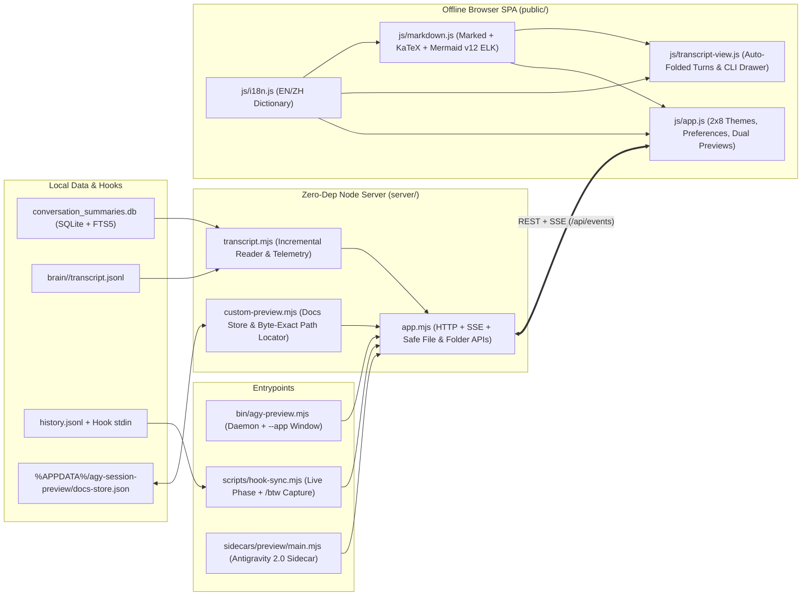

# HANDOFF — Antigravity Session Preview (`agy-session-preview`)

> **Last Updated**: 2026-11-28
> **Current Version**: `v0.4.2`
> **Repository**: `E:\OpenSources2\agy_plugin\antigravity-markdown-preview`
> **Remote**: `git@github.com:ChengzhuUwU/antigravity-session-preview.git` (`https://github.com/ChengzhuUwU/antigravity-session-preview`)

This document provides complete architectural context, user UX contracts, platform gotchas, verification commands, and prioritized next tasks so a new Agent can take over development immediately without regressions.

---

## 1. Environment & Deployment Map

| Component | Path / Value | Notes |
|---|---|---|
| **Source Repository** | `E:\OpenSources2\agy_plugin\antigravity-markdown-preview` | Primary git working tree (`main` branch) |
| **Installed Global Plugin** | `C:\Users\24017\.gemini\config\plugins\agy-session-preview` | Synced via `npm run install-plugin` ([scripts/install-plugin.mjs](scripts/install-plugin.mjs); removes legacy `agy-markdown-preview` install) |
| **Global CLI Shim** | `C:\Users\24017\.local\bin\agy-preview.cmd` | Invokes installed `bin/agy-preview.mjs` from any terminal |
| **Runtime Lock & Logs** | `C:\Users\24017\.gemini\cache\agy-session-preview\` | Ephemeral `server.json` (`{ pid, port, startedAt }`) & `server.log` |
| **Persistent User Data** | `%APPDATA%\agy-session-preview\` (`C:\Users\24017\AppData\Roaming\agy-session-preview`) | `docs-store.json`, `clips\*.txt`, `btw-notes.json`, and `saved-turns\` (a saved conversation turn, including tool calls; macOS: `~/Library/Application Support/...`, Linux: `~/.local/share/...`) |
| **Distributable Zip** | `dist/agy-session-preview.zip` | Built via `npm run pack-plugin`, validated with `agy plugin validate --strict` |
| **Runtime Engine** | Node.js `>= 22.5.0` | Uses built-in `node:http`, `node:sqlite` (`DatabaseSync`), and `node:test`; **zero runtime npm dependencies** |

### Release History Ledger

| Date | Tag / Version | Commit | Highlights |
|---|---|---|---|
| 2026-11-29 | unreleased | working tree | Save a full turn or `/btw` exchange and reopen it from `Saved Turns`; Fit columns wrap a long cell instead of adopting its width; `折叠项目&会话` also hides sessions older than three days; the project unread dot follows only the sessions already on screen |
| 2026-11-28 | `v0.4.2` | `v0.4.2` | OS-native file dialog with a Linux fallback chain; sidebar project/session order frozen for the open window; Markdown `Rendered` / `Source` toggle that keeps the viewport center; lone `~` is not strikethrough; transcript cache drops a rewritten head (`/rewind`); `Tables: Expand` column cap is `30vw`; per-turn copy and long-prompt fold; per-conversation file sidebar and tools; `/schedule` wakeups as their own turns |
| 2026-11-27 | unreleased | `d9de923` | `/schedule` wakeups render as their own turns (`定时巡检 #N` on the card and in the Outline); user-turn indexes still count only user messages |
| 2026-11-26 | unreleased | `d9a9d66` | Outline lead-label fallback for heading-less replies (`h4`–`h6` included, clamped to level 3); per-turn `Copy prompt` / `Copy response` plus 6-line fold for long user input; per-conversation right file sidebar and `/btw` · `/context` · `/usage` tab (in-page memory only) |
| 2026-11-26 | `v0.4.1` | `55f01ae` | Interactive user-decision prompts (`ask_question` & `exit_plan_mode` cards + `⏳ Awaiting Decision` topbar/sidebar/toast alerts); interrupted/canceled turn detection (`USER_CANCELED` + SQLite idle sync + `TranscriptReader` cache invalidation + non-streaming execution/command output copy); navigation race/jump fixes (`--focus` vs non-intrusive switch toast, in-place `--restart`, per-tab `sessionStorage`, sidebar hover freeze); left-sidebar top-left collapse button for narrow windows |
| 2026-11-26 | `v0.4.0` | `ce34cb7` | Custom theme-native `PDF.js v4` + offline Office (`Word .docx/.doc`, `Excel .xlsx/.xls/.ods`, `PowerPoint .pptx/.ppt`) viewers; 3-state session status (Apple 12-spoke spinner + `Unread` completed highlight); `Font Size` (`12px–24px` + `↺`) + decoupled `Latin × CJK` collapsible font pickers (`Times New Roman`, `华文宋体`, `楷体`, `仿宋`); multi-candidate named Custom RGB palettes (`custom-palettes.json`); live `update_steps` checklist & `agy-preview --restart` |
| 2026-11-25 | `v0.3.1` | `98d2e56` | Adaptive horizontal-fill Mermaid sizing + `↔ Expand` / `↔ Fit Width`; sub-second SSE live streaming + `task-*.log` tail + progressive `--stdin`; `★ Pinned` sessions above projects; one-click project folder collapse/expand; verified Windows Explorer `📂 Folder` + in-app directory browser fallback; standardized `/preview` on `agy-preview` |
| 2026-11-25 | `v0.3.0` | `15f262f` | Renamed plugin to `agy-session-preview` (`Session Preview`); optional server password auth (`server/auth.mjs` + CLI `password set/cancel/disable/activate/print`), inline PDF/video/audio/CSV previews with HTTP `Range` (`206`) streaming, foreground Windows `📂 Folder` + cross-platform file picker fix, user-resizable larger `#mermaid-modal`, and live two-color Custom RGB palette panel |
| 2026-11-24 | `v0.2.1` | `b3f9872` | Unified persistent `Preferences ▾` menu left of `↻ Sync`; full bilingual UI (`English` default / `简体中文`) across topbar, Mermaid, previews, and CLI tools |
| 2026-11-24 | `v0.2.0` | `9b118de` | Offline `mermaid@12.3.0` + built-in **ELK** orthogonal layout, rounded 90° elbows, GPT-style multi-stage pastel pills, pan/zoom & fullscreen modal (`#mermaid-modal`) |
| 2026-11-24 | `v0.1.0` | `1330b0a` | `2 × 8` theme system, project-grouped sessions, SQLite FTS5 prompt search, collapsed `Execution process`, dual file previews, persistent `Docs / Clips`, `/btw` · `/context` · `/usage` inspector |

---

## 2. System Architecture & Module Map



### Core Source Files

- **Plugin Manifests & Hooks**:
  - [plugin.json](plugin.json#L1-L12) — Plugin metadata (`agy-session-preview`, `v0.2.1`).
  - [hooks.json](hooks.json#L1-L44) — Subscribes `scripts/hook-sync.mjs` to `SessionStart`, `PreInvocation`, `PostToolUse`, `PostInvocation`, and `Stop` (3s timeout, fail-open).
  - [skills/preview/SKILL.md](skills/preview/SKILL.md) — `/preview` slash command instructions for `agy`.
  - [sidecars/preview/main.mjs](sidecars/preview/main.mjs#L1-L64) & [sidecars/preview/sidecar.json](sidecars/preview/sidecar.json) — Antigravity 2.0 Desktop `sidecar://agy-session-preview/preview/` adapter with `x-sidecar-token` validation.
- **CLI & Build Scripts**:
  - [bin/agy-preview.mjs](bin/agy-preview.mjs#L1-L342) — Standalone CLI (`--conv`, `--file`, `--stdin`, `--status`, `--stop`, `--foreground`), background daemon spawner, and Chromium/Edge `--app=<url>` launcher.
  - [scripts/hook-sync.mjs](scripts/hook-sync.mjs#L59-L165) — Forwards live invocation phases to `/api/hook-event` and intercepts ephemeral `/btw` side-question fork transcripts before `agy` deletes them, archiving answers into `btw-notes.json`.
  - [scripts/sync-vendor.mjs](scripts/sync-vendor.mjs), [scripts/install-plugin.mjs](scripts/install-plugin.mjs), [scripts/pack-plugin.mjs](scripts/pack-plugin.mjs) — Offline vendor bundler (`marked`, `highlight.js`, `katex` + fonts, `mermaid` v12 single-file ESM bundle), global plugin installer, and `.zip` packager.
- **Backend Server (`server/`)**:
  - [server/app.mjs](server/app.mjs#L188-L258) — `resolveSafeFilePath()` (handles `file://`, Windows drive paths, ancestor `.git` roots, bare filenames via `findBareFileUnderRoot()`, directory `README.md` auto-resolution, and credential path blocking).
  - [server/app.mjs](server/app.mjs#L301-L857) — `createPreviewEngine()` serving `/api/conversations`, `/api/conversations/:id/view`, `/api/conversations/:id/btw-notes`, `/api/saved-turns`, `/api/file-info`, `/api/raw-file`, `/api/reveal-in-folder`, `/api/previews`, `/api/pick-file`, `/api/hook-event`, `/api/focus`, and `/api/events` (SSE). Saved turns live in `saved-turns/` beside the docs store.
  - [server/transcript.mjs](server/transcript.mjs#L190-L330) — `listConversations()` reading `conversation_summaries.db` + `conversations_fts` (`user_body` full-text search) + project names from `~/.gemini/config/projects/*.json`.
  - [server/transcript.mjs](server/transcript.mjs#L650-L950) — `TranscriptReader` (byte-offset incremental `.jsonl` tailing) & `buildNormalizedView()` (turn grouping, `/schedule` wakeups as their own turns, `edit_file` unified diff extraction, intermediate vs final Markdown tagging, `/context` 10×10 token estimation, and `/usage` 5h/7d rolling aggregation).
  - [server/custom-preview.mjs](server/custom-preview.mjs#L126-L185) — `locateDroppedFileOnDisk()` (matches browser-dropped files byte-for-byte across known workspaces so relative links resolve against the true source folder) & `CustomPreviewStore` (`docs-store.json` + `clips/`).
- **Frontend SPA (`public/`)**:
  - [public/index.html](public/index.html#L56-L92) — Topbar layout (`#prefs-dropdown-wrap` immediately left of `#sync-btn`, `#jump-top-btn`/`#jump-bottom-btn`, `#tools-dropdown-wrap`, `#export-btn`, and `#toc-toggle-btn` at far top-right) + `plugin:` Blob module loader ([public/index.html](public/index.html#L240-L274)).
  - [public/js/i18n.js](public/js/i18n.js#L1-L416) — Bilingual dictionary (`en` default, `zh` Simplified Chinese) + `getLang()`, `setLang()`, `t()`, `applyStaticI18n()`.
  - [public/js/markdown.js](public/js/markdown.js#L261-L497) — Block-memoized `Marked` + `KaTeX` + CJK bold fix + GitHub/Obsidian Alerts (`[!NOTE]`..`[!CAUTION]`) + expandable wide tables (`Tables: Expand`, `max-width: 30vw` per column).
  - [public/js/markdown.js](public/js/markdown.js#L499-L760) — Mermaid v12 + ELK orthogonal layout (`layout: 'elk'`), `roundOrthogonalSvgPath()`, `polishMermaidSvgToGptStyle()`, `bindPanZoomViewport()`, and `.svg` vector export.
  - [public/js/transcript-view.js](public/js/transcript-view.js#L583-L995) — `TranscriptRenderer` (signature-diffed DOM updates, auto-collapsed `Execution process`, inline subagent cards, and `/btw` · `/context` · `/usage` drawer rendering).
  - [public/js/app.js](public/js/app.js#L78-L235) — `renderPrefsMenu()`, `applyAppearance()`, `applyLanguage()`, SSE live sync, project-grouped sidebar, `Docs / Clips` hover preview + drag-reorder + inline rename, popup modal (`#file-preview-modal`), and split side preview (`#side-preview-pane`).
  - [public/styles.css](public/styles.css) — `2 × 8` theme tokens (`html[data-theme="light|dark"][data-palette="..."]`), layout flexbox hierarchy, callouts, tables, and pan/zoom canvases.
- **Tests**:
  - [tests/preview.test.mjs](tests/preview.test.mjs) — 8 unit & integration test suites covering tool arg unquoting, normalized transcript views, `/context` + `/usage` telemetry, hyperlink classification, byte-exact dropped-file path resolution, incremental JSONL tailing, `stream-json` parsing, and HTTP/SSE security boundaries.

---

## 3. Non-Negotiable User UX Contracts (Do Not Regress!)

When modifying the UI or docs, strictly preserve these explicit user design decisions:

1. **Zero `Claude Code` / `Claude Desktop` Branding**: Never mention or compare against `Claude Code` in UI labels, code comments, `README.md`, `CHANGELOG.md`, or commit messages.
2. **Unified `Preferences ▾` Menu Left of `↻ Sync`**:
   - All persistent display settings (`Language`, `Font: Sans / Serif`, `Width: Normal / Wide`, `Tables: Fit / Expand`, `2` Light/Dark modes, and `8` Color Palettes) live inside `#prefs-dropdown-wrap` immediately to the **left** of `#sync-btn`.
   - Inside `#prefs-menu`, keep the **`2` (`Light` / `Dark`)** mode options visually separated by a divider from the **`8` color palettes** (`parchment`, `lavender`, `sakura`, `matcha`, `glacier`, `amber`, `celadon`, `slate`).
   - Default UI language MUST remain **English (`'en'`)**, with complete real-time parity when toggled to **Simplified Chinese (`'zh'`)**.
3. **Top-Right `Outline` & Always-Collapsed Execution**:
   - Keep `Outline` (`#toc-toggle-btn`) at the **far top-right** of the topbar.
   - **Do NOT add global `Expand All` / `Collapse All` buttons**. Intermediate reasoning chains and tool calls stay folded inside per-turn `Execution process` cards by default (and auto-collapse when an active turn completes).
   - If a final assistant message or Docs/Clips body has no `#`–`######` heading, the Outline still shows one lead-word jump target. Existing headings win, and `h4`–`h6` appear clamped to level 3.
   - Subagents in the left `Sessions` tree stay collapsed by default (`▸ N subagents`), while remaining accessible inside the session view (`Subagents invoked in this session` + `Open Subagent` / `← Parent`).
4. **Open Session at Latest User Input**:
   - Opening a conversation scrolls automatically to the **last `.user-card`** (`scrollToLastUserTurn()`), while `⤒` / `⤓` topbar buttons jump to top/bottom on demand.
5. **Dual Hyperlink Preview Model**:
   - Clicking a local hyperlink directly opens the centered **Popup Preview Modal** (`#file-preview-modal`).
   - Clicking the adjacent **`Open in sidebar`** pill (rendered on all previewable Markdown/code/image links) opens the resizable **Right Split Pane** (`#side-preview-pane`).
   - Both views (plus the `Docs / Clips` Base Dir ribbon) provide **`📂 Folder`** (`POST /api/reveal-in-folder`) to select the file in OS Explorer/Finder.
   - `Docs / Clips` mode hides the `antigravity-cli` flavor dropdown since standalone docs are flavor-independent.
   - The right file pane and the `/btw` · `/context` · `/usage` drawer are **per conversation** for the current page. Switching sessions restores that session’s own open file/history and tool tab, or leaves both closed. Do not keep one global pane across conversations. Same-conversation refresh must not clear them. The split-pane width stays a shared layout preference.
6. **Per-Turn Copy and Long Prompt Fold**:
   - Each user card offers `Copy prompt` / `Copy response` (`复制提问` / `复制回复`) as plain text. The response is the final non-intermediate markdown plus decision plan/questions/answers, not execution-process chatter.
   - User prompts longer than 8 lines or 480 characters start collapsed to 6 lines (`Show more` / `Show less`). Fold state is per turn and clears when the conversation changes.
7. **Scheduled Checks Are Their Own Turns**:
   - A `/schedule` wakeup opens a new section like a user turn: the registered prompt is the card body, and that firing’s final reply stays outside `Execution process`.
   - The card and Outline title are `定时巡检 #N` when the prompt contains that name. Do not prefix them with `You · Turn #` / `你 · 第 # 轮`.
   - User-turn numbers count only real user messages. Background task-finished and “still running” notices stay inside the current `Execution process`.
8. **Sidebar Order Stays Put After the Window Opens**:
   - The first roster may follow recent activity. After that, project folders and the sessions inside them do not reshuffle when messages arrive.
   - A newly seen project is inserted at the top. A new session in an existing project is appended. `Unassigned` stays last. Pinned sessions keep star order. Opening the window again may take a fresh activity order.
9. **Markdown Source View Keeps the Centered Passage**:
   - Markdown in the main Docs view, the right file pane, and the popup offers `Rendered` / `Source` (`预览` / `源文`). The choice is remembered.
   - Switching views scrolls so the text that was at the center of the viewport stays at the center.

---

## 4. Critical Technical Gotchas

### Gotcha 1 — Antigravity 2.0 `plugin:` Sidecar Blob Module Loader
In Antigravity 2.0 Desktop sidecars, `window.location.protocol === 'plugin:'` disallows relative ES module imports directly over HTTP. [public/index.html](public/index.html#L249-L269) fetches each module in dependency order (`['js/i18n.js', 'js/markdown.js', 'js/doc-viewers.js', 'js/transcript-view.js', 'js/sidebar-order.js', 'js/app.js']`) and rewrites `'./<dep>'` specifiers to `Blob` URLs.
- **Rule**: If you create any new `public/js/*.js` module, add it to `files` in `public/index.html` **before** any file that imports it, and use standard `'./filename.js'` import syntax.

### Gotcha 2 — Language Keying in Memoized Markdown & Turn Signatures
`renderMarkdownHtml()` caches rendered HTML blocks in `blockHtmlCache` keyed by `` `${getLang()}\0${baseDir}\0${blk}` `` ([public/js/markdown.js](public/js/markdown.js#L484)), and `TranscriptRenderer` caches turn DOM nodes by `turn.dataset.signature` which includes `${getLang()}` ([public/js/transcript-view.js](public/js/transcript-view.js#L957)).
- **Rule**: Never hardcode English or Chinese UI strings inside `markdown.js`, `transcript-view.js`, or `app.js`; always add both `en` and `zh` keys to [public/js/i18n.js](public/js/i18n.js).

### Gotcha 3 — GFM Blockquote Alert Parsing (`> [!CAUTION]`)
GFM merges consecutive `>` lines without an empty `>` separator into a single `<p>` separated by `\n`. In [public/js/markdown.js](public/js/markdown.js#L380-L416), `blockquote()` matches `([^\n]*?)` strictly up to the first newline and wraps the header text inside `<span class="callout-title-text">` so `.callout-title` (`display: flex`) never treats inline `<code>` / `<strong>` elements as narrow 1-character flex columns.

### Gotcha 4 — Global Monospace `<code>` Styling on Windows
Style `code, kbd, samp` and `:not(pre) > code` **globally** in `public/styles.css` (not only inside `.assistant-markdown`). Unstyled `<code>` elements outside `.assistant-markdown` fall back to pixelated `SimSun` bitmap fonts on Chinese Windows. Avoid rare Unicode symbols (`⛁`) lacking Windows DirectWrite font coverage; use clean inline SVGs instead.

### Gotcha 5 — Windows PowerShell 5.1 & Always Launching via `agy-preview`
- On this Windows host, `powershell.exe` is PowerShell 5.1 where `&&` is invalid syntax. Chain shell commands with `; if ($LASTEXITCODE -ne 0) { exit $LASTEXITCODE }` and `$ErrorActionPreference = 'Stop'`.
- Always launch/manage the preview server using the global `agy-preview` CLI (`agy-preview --status`, `agy-preview --stop`, `agy-preview --conv <id>`). Note that processes spawned inside `agy`'s `run_command` sandbox cannot invoke Windows Desktop `explorer.exe` via DDE (`openedInOs: false`, falling back to the in-app directory browser), whereas `agy-preview` started from an external terminal has full Medium-Integrity Desktop Explorer permissions (`openedInOs: true`).
- Never register `PreToolUse` in `hooks.json` (`PreToolUse` is a gating security hook in `agy` CLI; live streaming is handled non-blockingly via `SessionStart` / `PreInvocation` / `PostToolUse` / `PostInvocation` / `Stop` plus the `280ms` server-side byte-offset poller).

---

## 5. Development, Verification & Release Workflow

```powershell
$ErrorActionPreference = 'Stop'
Set-Location 'E:\OpenSources2\agy_plugin\antigravity-markdown-preview'

# 1. Fast syntax check across all frontend & backend modules
node --check public/js/i18n.js; if ($LASTEXITCODE -ne 0) { exit $LASTEXITCODE }
node --check public/js/markdown.js; if ($LASTEXITCODE -ne 0) { exit $LASTEXITCODE }
node --check public/js/transcript-view.js; if ($LASTEXITCODE -ne 0) { exit $LASTEXITCODE }
node --check public/js/app.js; if ($LASTEXITCODE -ne 0) { exit $LASTEXITCODE }
node --check server/app.mjs; if ($LASTEXITCODE -ne 0) { exit $LASTEXITCODE }
node --check server/transcript.mjs; if ($LASTEXITCODE -ne 0) { exit $LASTEXITCODE }
node --check server/custom-preview.mjs; if ($LASTEXITCODE -ne 0) { exit $LASTEXITCODE }

# 2. Run automated unit & integration tests (Node built-in test runner)
npm test; if ($LASTEXITCODE -ne 0) { exit $LASTEXITCODE }

# 3. Install to ~/.gemini/config/plugins/agy-session-preview & pack dist zip
npm run install-plugin; if ($LASTEXITCODE -ne 0) { exit $LASTEXITCODE }
npm run pack-plugin; if ($LASTEXITCODE -ne 0) { exit $LASTEXITCODE }

# 4. Strict Antigravity plugin schema validation
agy plugin validate --strict "$HOME\.gemini\config\plugins\agy-session-preview"
agy plugin validate --strict "dist\agy-session-preview.zip"
```

> **Note on Reloading**: If the user already has `agy-preview` running in the background while you update `server/*`, run `agy-preview --stop` so their next `agy-preview` or `/preview` invocation spawns the updated server code. Frontend-only changes under `public/` take effect immediately after `npm run install-plugin` + browser refresh (`Ctrl+R`) because `server/app.mjs` serves `public/` with `Cache-Control: no-store`.

---

## 6. Candidate Next Tasks & Backlog

1. **De-noise Recovered CLI Stream Retry Errors (`API error (attempt N)`)**:
   - **Context**: When a local TUN proxy (`198.18.0.0/15`) resets a long-lived SSE connection, `agy` writes `ERROR_MESSAGE` steps like `API error (attempt 1): stream reading error...` and may leave an interrupted `PLANNER_RESPONSE`'s `tool_calls` in `pendingToolsQueue` (`status: 'running'`) before succeeding on retry ([server/transcript.mjs](server/transcript.mjs#L758-L847)).
   - **Proposed Improvement**: Detect `^API error \(attempt \d+\):` steps that are followed by successful model/tool steps in the same turn; collapse them into a compact muted retry badge (`⟳ Retried transient network drop ×N`) instead of bright red error banners, exclude recovered retries from `summary.totalErrors`, and mark orphaned pre-retry `pendingToolsQueue` entries as `retried` instead of `running`.
2. **Cross-Platform Native File Picker (`macOS` / `Linux`)** — shipped, unreleased:
   - `server/file-picker.mjs` selects Windows PowerShell, macOS `osascript`, or the first installed Linux tool among `zenity`, `kdialog`, `qarma`, and `yad`. `GET /api/file-picker` hides Browse when none is available.
3. **Inline PDF & Video Preview in Popup / Split Sidebar**:
   - **Context**: `classifyFile()` ([server/app.mjs](server/app.mjs#L260-L269)) currently renders `markdown`, `code` (with `#Lstart-Lend` line highlights), and `image`, showing a binary notice + `📂 Folder` button for `.pdf` / `.mp4` / `.webm`.
   - **Proposed Improvement**: Add `kind: 'pdf'` (`<iframe>` / `<embed>` backed by `/api/raw-file`) and `kind: 'video'` (`<video controls>` with HTTP `Range` support in `/api/raw-file`) so research paper PDFs and rollout `.mp4` videos preview inline.
4. **Mermaid Diagram Search Highlighting & Minimap (Optional)**:
   - Allow `Ctrl+K` in-page search to match text inside rendered Mermaid `<svg>` labels and pan/zoom the inline canvas to the matched node.
5. **Per-Column Width for `Tables: Fit`** — implemented in `public/js/table-layout.js`:
   - **Keep**: `Tables: Expand` stays natural width with a **single-column cap of `30vw`**. Do not revert that cap, and do not run the Fit optimizer while a table is expanded.
   - **Fit**: each column is sized inside the reading pane. A long cell wraps instead of setting the column. Leftover pane width goes to columns that are still wrapping, not to columns that already fit. A cell that still wraps past five lines gets `展开` / `收起`. The longest unbreakable token can force a column only up to about four CJK widths; longer tokens may break.
   - **Do not restore** the 2026-11-27 score (`coverage - 1.15 * waste - 0.2 * extra lines past 2`). That pass made Fit look worse than a full-width table on `EXPERIMENT_REPORT.md`.
